<div align="center">


# My Places

**See every state and country you've been to, from your Google Maps history.**

A mobile-first, installable web app. Import your Google Takeout or phone Timeline export and get a map of
India and the world, shaded by how often you've visited each place, plus yearly stats and a shareable travel card.


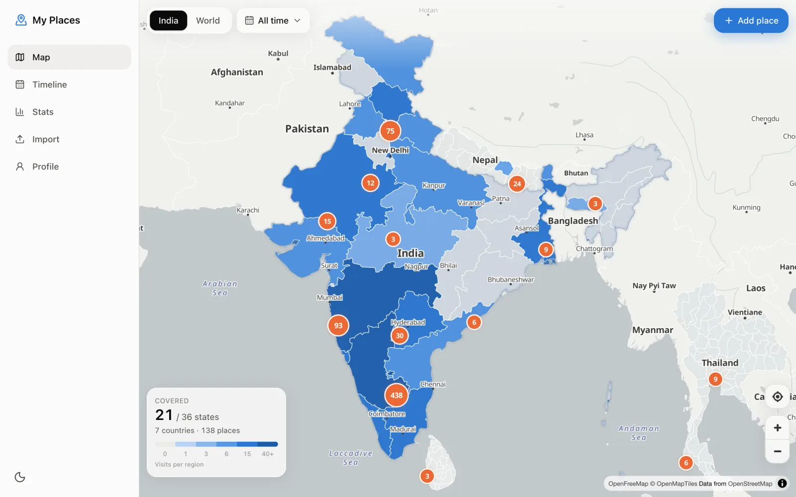

<table>
  <tr>
    <td>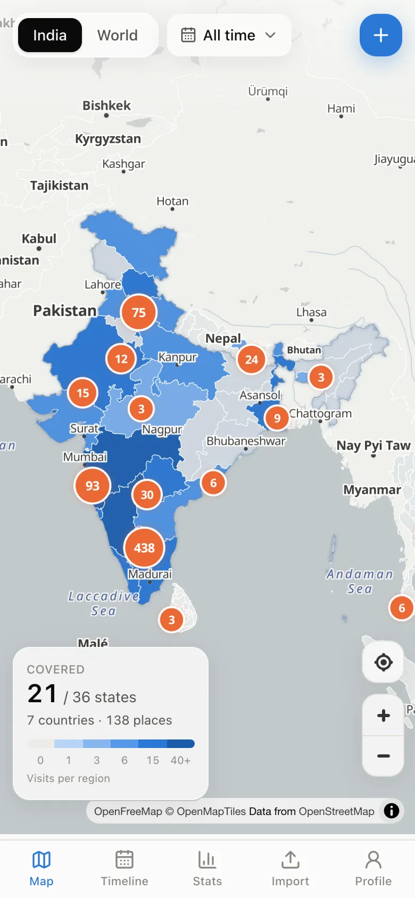</td>
    <td>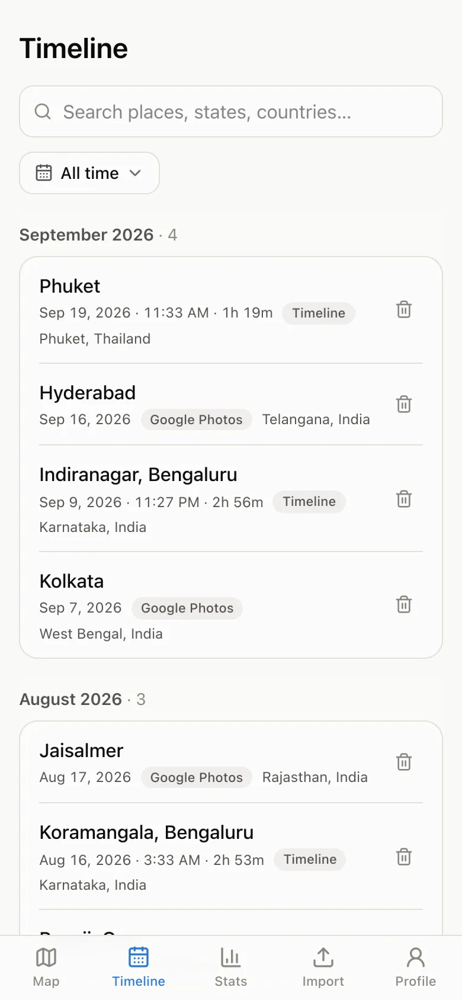</td>
    <td>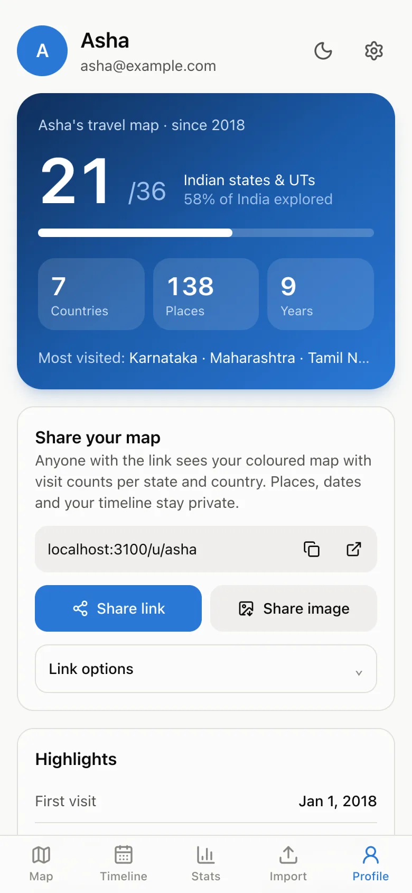</td>
    <td>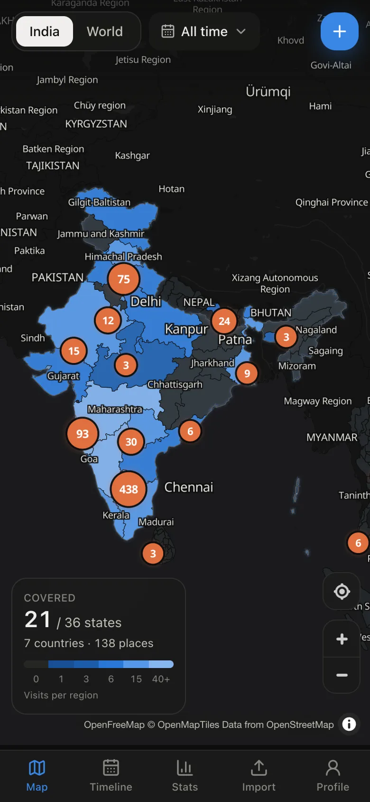</td>
  </tr>
</table>

</div>

## Features

- **India with official boundaries.** States and UTs are drawn from Survey of India–aligned data, so Jammu & Kashmir and Ladakh appear in full.
- **The whole world too.** Trips abroad colour in countries and their states or provinces.
- **Shaded by visits.** Each region darkens with how often you've been there, with a count bubble for each area and a running "21 / 36 states" total.
- **Imports everything Google gives you.** Takeout reviews, Maps photos, labelled places, the phone Timeline export, older Location History and Google Photos locations. You can also add places by hand.
- **Private by design.** Files are read on your device; only the extracted locations are uploaded, never photos.
- **No duplicates.** Re-importing the same export adds nothing, overlapping Timeline exports are merged, and visits you delete stay deleted.
- **Timeline and stats.** Search every visit, filter by year, and see visits per year, top states and where the data came from.
- **Share your map.** A public link shows only your coloured map and per-region counts. Places, dates and your timeline stay private. Or share a ready-made image card.
- **Works like an app.** Installable, works offline with your last-seen data, has light and dark themes, and is built for phones first.

## Screenshots

<table>
  <tr>
    <td width="50%">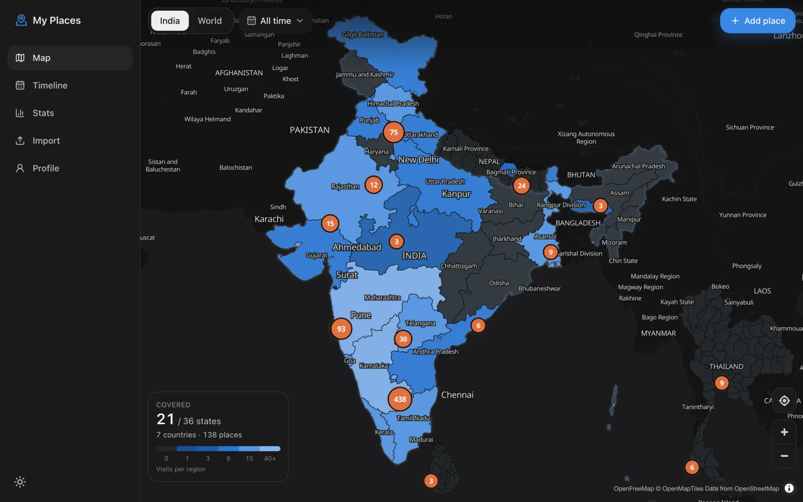<br /><sub>Dark mode</sub></td>
    <td width="50%">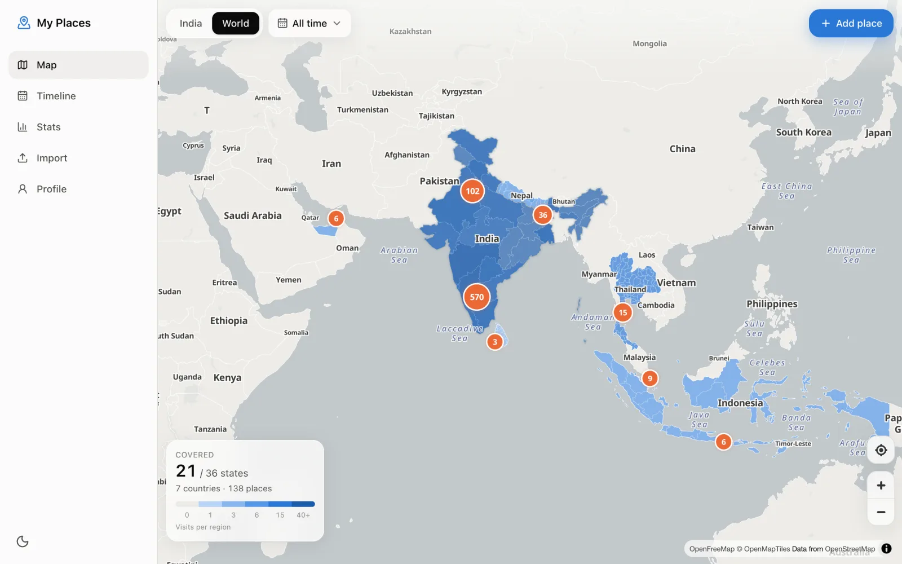<br /><sub>World view</sub></td>
  </tr>
  <tr>
    <td>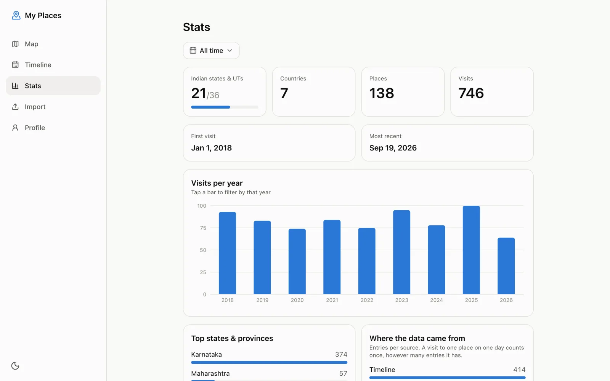<br /><sub>Stats, filterable by year</sub></td>
    <td>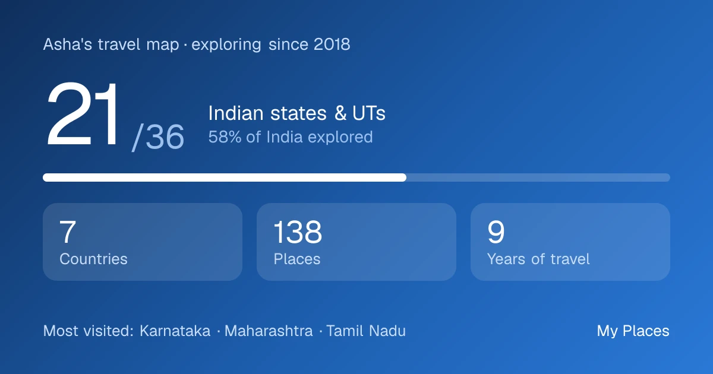<br /><sub>Share card (also the link preview image)</sub></td>
  </tr>
</table>

<table>
  <tr>
    <td width="25%">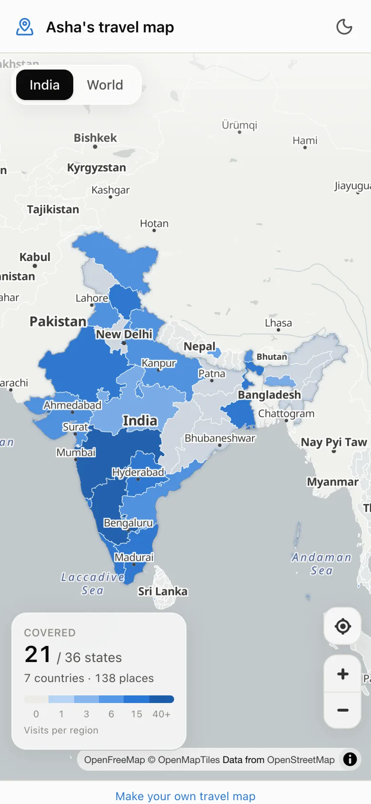<br /><sub>Public link: map and counts only</sub></td>
    <td width="25%">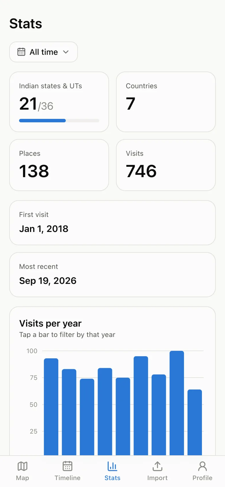<br /><sub>Stats</sub></td>
    <td width="25%">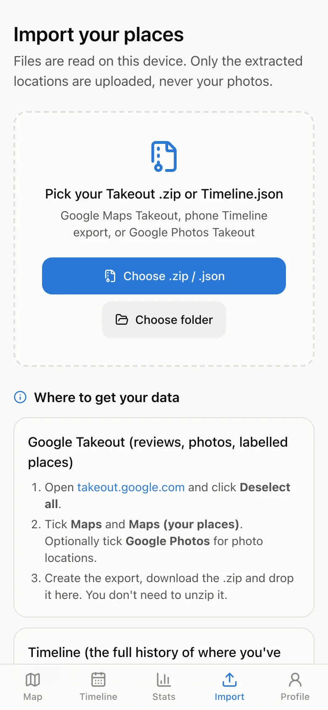<br /><sub>Import</sub></td>
    <td width="25%"><br /><sub>Timeline</sub></td>
  </tr>
</table>

## Quick start

You need Node.js 22+ and Docker (for MongoDB).

```bash
docker compose up -d mongo        # MongoDB on :27017
cp .env.example .env.local        # then set AUTH_SECRET (openssl rand -base64 32)
npm install                       # also copies the MapLibre worker into public/
npm run dev                       # http://localhost:3000
```

Create an account, open **Import** and drop in your Takeout `.zip` or `Timeline.json`.

**On your phone:** run `npm run dev -- -H 0.0.0.0` and open `http://<your-LAN-IP>:3000`.
Installing the PWA and the service worker need HTTPS (or localhost), so for install testing use a tunnel
(e.g. `cloudflared tunnel --url http://localhost:3000`) or `npm run build && npm start` behind HTTPS.

**Switching theme:** the moon/sun button on the Profile page (sidebar on desktop) switches between light and dark. Settings → Appearance also offers "System" to follow the device.

### Configuration

| Variable | Required | Default | What it does |
| --- | --- | --- | --- |
| `MONGODB_URI` | yes | `mongodb://localhost:27017/myplaces` | MongoDB connection string |
| `AUTH_SECRET` | yes | | Signs session cookies. Generate with `openssl rand -base64 32` |
| `AUTH_TRUST_HOST` | no | `true` in the example | Needed when the app is reached through a LAN IP, tunnel or proxy |
| `DAY_TIMEZONE` | no | `Asia/Kolkata` | Time zone that decides which calendar day a visit falls on |

### Docker

`docker compose --profile app up --build` runs the production container next to MongoDB on :3000.
`docker compose --profile tools up -d` adds mongo-express on :8081 for browsing the database.

## Importing data

| Source | What it gives |
| --- | --- |
| Google Takeout → **Maps** + **Maps (your places)** | Reviews (place, date, rating, text), Maps photo GPS, labelled places, suggested edits, geocode contributions |
| Phone **Timeline export** (`Timeline.json`, Android or iOS) | Full visit history. Google no longer includes Timeline in Takeout |
| Legacy `Semantic Location History/*.json`, `Records.json` | Older Takeout location history (raw points are collapsed to one per ~5 km per day) |
| Google Takeout → **Google Photos** | GPS and date from photo sidecar JSON |
| Manual | Search a place (Photon/OSM) or drop the crosshair, then pick a date |

Zip files are read in the browser through their central directory, so only the `.json` entries are
decompressed and only the extracted visits are uploaded. Re-importing the same export is a no-op,
because every visit has a dedupe key.

### Getting your data

- **Takeout:** go to [takeout.google.com](https://takeout.google.com), click **Deselect all**, tick **Maps** and **Maps (your places)** (and **Google Photos** for photo locations), then download the `.zip`. There's no need to unzip it.
- **Timeline:** on Android, Settings → Location → Location services → Timeline → **Export Timeline data**. On iOS, Google Maps → profile → Settings → Personal content → **Export Timeline data**.

The Import page walks through both steps.

## Privacy

- Exports are parsed in the browser. Photos and the raw files never leave your device.
- Passwords are hashed with bcrypt, and sessions are signed JWT cookies.
- Profiles are private until you create a share link. A shared link shows the coloured map and per-region counts only: no places, dates, timeline or year filter. You can rename or stop the link at any time.
- Settings → **Delete all visits** removes your data.

## Duplicates and counting

Every import batch (≤1000 entries) is filtered on the server, in this order:

1. **Already imported:** same source, place (~11 m), minute and name (`dedupeKey`). A unique index on `{userId, dedupeKey}` backs this up.
2. **Deleted before:** deleting an imported visit leaves a tombstone (`DeletedVisit`), so re-importing the same export doesn't bring it back. Settings → "Allow re-import" clears tombstones, and "Delete all visits" is a fresh start.
3. **Same Timeline stay from another export:** Timeline records that overlap in time (±15 min), lie within 200 m and don't have different Google place IDs are one stay. The kept record's end time is extended to cover both. Tombstoned stays count too.

Counting: a **visit** is a distinct place (~110 m cell) per calendar day (`DAY_TIMEZONE`, default `Asia/Kolkata`). A Timeline stay, three photos and a review at one spot on one day count once. "Where the data came from" still shows raw entries per source.

## Scaling

Rough sizing at 10k users with ~5k entries each: 50M visit documents, roughly 40–60 GB with indexes. A 3-node MongoDB replica set handles this; shard on `userId` beyond that.

- **Every query is per user:** they all start with `userId` and are covered by compound indexes (`userId+dedupeKey`, `userId+visitedAt`, `userId+source+visitedAt`, `userId+countryCode+stateCode`), so cost grows with one user's data, not the user base.
- **Parsing happens in the browser:** a 50 MB Timeline never reaches the server; only normalised batches do (well under the 4.5 MB body limit).
- **Import cost per batch:** three indexed reads (existing keys, tombstones, nearby stays) and one unordered `bulkWrite`. State/country lookup is memoised on an ~11 m grid (home and office hit the cache).
- **Reads are cached per user:** map, stats and points use `"use cache"`, keyed by `User.dataVersion`. Each write bumps the version, so a fresh import shows on the next request and repeat or public-profile views skip the aggregations.
- **Multiple app instances:** the default cache lives in memory per instance. It stays correct because of the version key, but each instance warms its own. Add a shared cache handler (e.g. Redis) when running several.
- **Not done yet:** rate limiting on `/api/import` and `/api/register`, an import queue if many users import at once (lookups are CPU-bound on the request thread), and paging `/api/points` for users with more than 20k entries.

## Project layout

```
scripts/prepare-geo.mjs       downloads + simplifies boundary data → data/geo (server) & public/geo (client)
src/lib/parsers/              pure parsers for every export format (unit tested against ../Takeout)
src/lib/geo/regions.ts        point-in-polygon → country + state, run at import time
src/lib/data.ts               aggregation queries (regions, stats, points, visits)
src/app/api/*                 REST routes; GETs accept ?slug= for public profiles
src/components/map/           MapLibre canvas, explorer UI, heat colours
public/sw.js                  offline shell, cached tiles/boundaries, last-seen API data
```

## Scripts

| Command | What it does |
| --- | --- |
| `npm run dev` | Dev server with Turbopack |
| `npm run build` / `npm start` | Production build and server |
| `npm test` | Vitest: parsers, region assignment and dedupe |
| `npm run lint` | ESLint |
| `npm run geo` | Rebuild boundary GeoJSON (downloads cached in `.geo-cache/`) |

Parser tests read a real export from `../Takeout` and are skipped when it's missing.

## Adding Google sign-in later

Add `Google` from `next-auth/providers/google` to `src/auth.ts`, set `AUTH_GOOGLE_ID` and `AUTH_GOOGLE_SECRET`,
and in the `signIn` callback link the account to the `User` by email.

## Credits

- Map tiles: [OpenFreeMap](https://openfreemap.org), © [OpenMapTiles](https://openmaptiles.org), data © [OpenStreetMap](https://www.openstreetmap.org/copyright) contributors
- Boundaries: [Natural Earth](https://www.naturalearthdata.com) and [india-maps-data](https://github.com/udit-001/india-maps-data)
- Place search: [Photon](https://photon.komoot.io) by Komoot
- Not affiliated with Google. "Google Maps" and "Google Photos" are trademarks of Google LLC.
